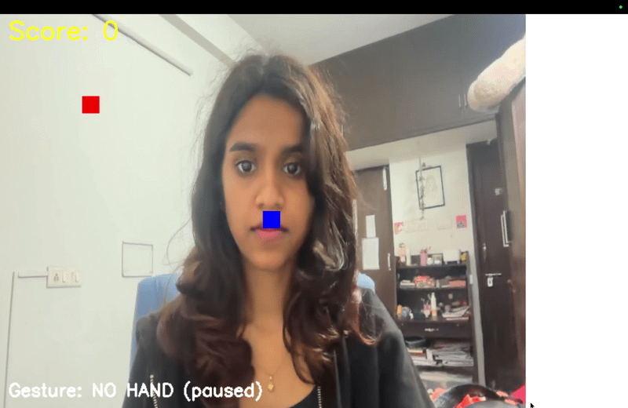

# Hand Gesture Snake Game

A classic Snake game controlled with hand gestures through your webcam instead of the keyboard. Built as a fun experiment with real-time computer vision.



## Controls

| Gesture | Action |
|---|---|
| Point with your index finger (up / down / left / right) | Steer the snake in that direction |
| Open hand | Snake keeps moving in its current direction |
| Closed fist | Pause |
| No hand in view | Pause |

The game starts paused until a hand is detected. Press `ESC` to quit.

## How it works

- **Capture:** OpenCV reads the webcam feed, mirrors it, and resizes it to 640x480. The game is drawn directly on top of the video.
- **Hand tracking:** MediaPipe Hands detects 21 landmarks on a single hand in real time.
- **Finger detection:** A finger counts as extended if its tip is farther from the wrist than its middle (PIP) joint. This works at any hand rotation.
- **Pointing direction:** The direction is the vector from the index knuckle to the index fingertip. The larger axis (horizontal or vertical) decides the direction, and a minimum length filters out small, accidental movements.
- **Game logic:** The snake moves on a fixed timer on a 20px grid, wraps around the screen edges, grows when it eats food, and the game restarts when it hits itself. 180-degree turns are blocked.

## Tech used

- Python
- OpenCV (`cv2`) for video capture and drawing
- MediaPipe for hand landmark detection
- NumPy for the finger-distance calculations

## Installation

```bash
git clone https://github.com/<Jananisrinivasan9876>/hand-gesture-snake-game.git
cd hand-gesture-snake-game
python3 -m pip install -r requirements.txt
```

## Run

```bash
python3 snake_game.py
```

Make sure your webcam is connected. On macOS, allow camera access for your terminal or IDE in System Settings > Privacy & Security > Camera.

## Settings

You can tweak these constants at the top of `snake_game.py`:

- `STEP_DELAY`: seconds per snake move (lower = faster)
- `MIN_POINT_LEN`: minimum finger length in pixels to count as a pointing direction
- `CELL`: size of each grid cell

## Tips

- Works best with good lighting and a plain background.
- Keep your hand fully visible and a comfortable distance from the camera.
